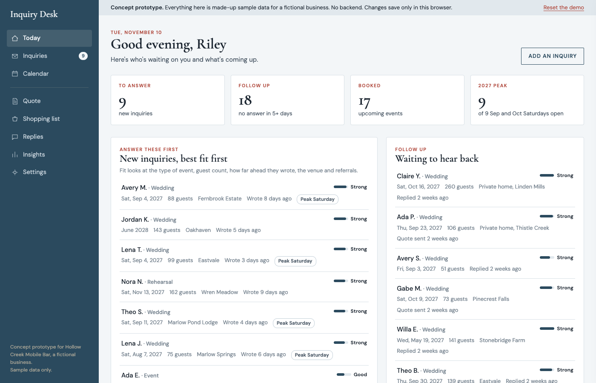

# Inquiry Desk (concept prototype)

A clickable, single-file back-office mockup for a small events business. It shows what a calmer way to handle wedding and event inquiries could look like, using a **fictional** business, "Hollow Creek Mobile Bar".



**This is a concept prototype with no backend.** There is no database, no email, no login. Everything you click is saved only in your own browser, and "Reset the demo" puts it all back. **All names, venues, towns, dates, guest counts and prices are randomly generated sample data.**

## The problem

I built this after working with a two-owner mobile bar business. The owner was answering inquiries straight from Gmail:

- Every inquiry looked the same in the inbox, so the best-fit ones were not obvious.
- Follow-ups depended on memory. Nobody was told "this person has not heard from you in a week."
- The business runs from a single trailer, so one date can only be booked once. Availability was checked by hand against a calendar.
- Quotes, shopping lists and replies were rebuilt from scratch each time.

## What the demo shows

- **Today:** new inquiries ranked by fit, follow-ups with no answer in 5+ days, next events, and open peak Saturdays.
- **Inquiries:** search and filter. Each opens a panel with the facts, bartenders needed, a fit score with its reasons, stage buttons, notes and a filled-in reply draft.
- **Calendar:** a month view with bookings, holds and inquiries per day, and warnings for date clashes and staffing.
- **Event file:** a checklist with due dates counted back from the event day.
- **Quote:** setup, guests, hours and add-ons add up, with a deposit, ready to copy into an email.
- **Shopping list:** drinks, mixers, ice and glassware for the guest count.
- **Replies:** editable reply templates (first reply, date taken, checking in, quote follow-up, booked next steps, not a fit, venue note, review ask).
- **Insights:** charts built from the sample data.
- **Settings:** prices, team size, shopping amounts and how fit is scored.

## Open it

Double-click `inquiry-desk.html`. It is one file and works offline. Fonts load from Google Fonts when there is internet.

## Rebuild

```bash
python3 -I build.py
```

`src/desk.html` is the app (HTML, CSS and JavaScript, no libraries). `build.py` generates synthetic inquiries from a fixed random seed and writes `inquiry-desk.html`. It reads no outside data. Change `SEED` in `build.py` for a different set.

## What a real version would need

1. A database so the owners share one copy, behind a login.
2. New inquiries arriving on their own, from a website form or email alerts.
3. Private hosting.
4. The owners' real prices, drink amounts and fit rules in Settings.

## License

MIT. See `LICENSE`. Business name, people, venues and towns are fictional.
